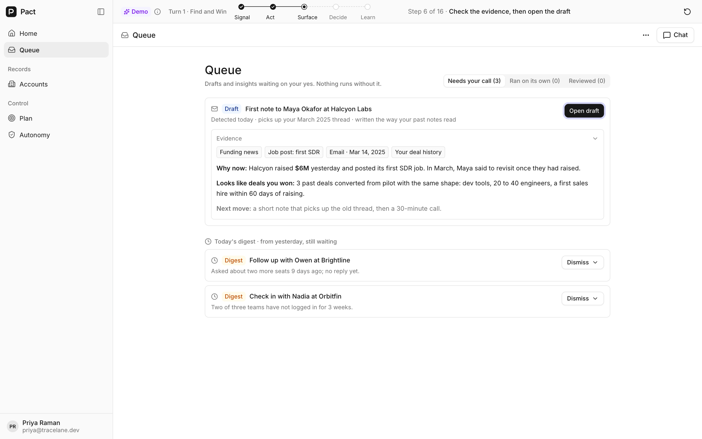
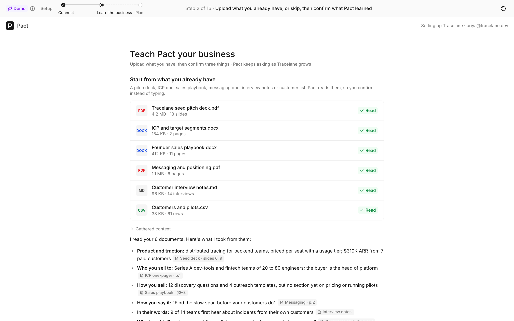
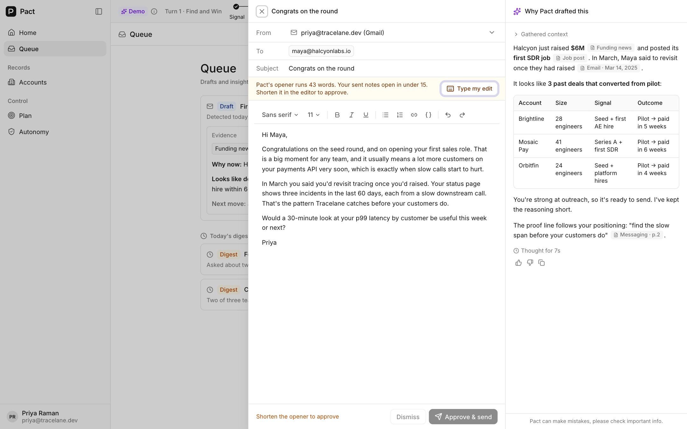
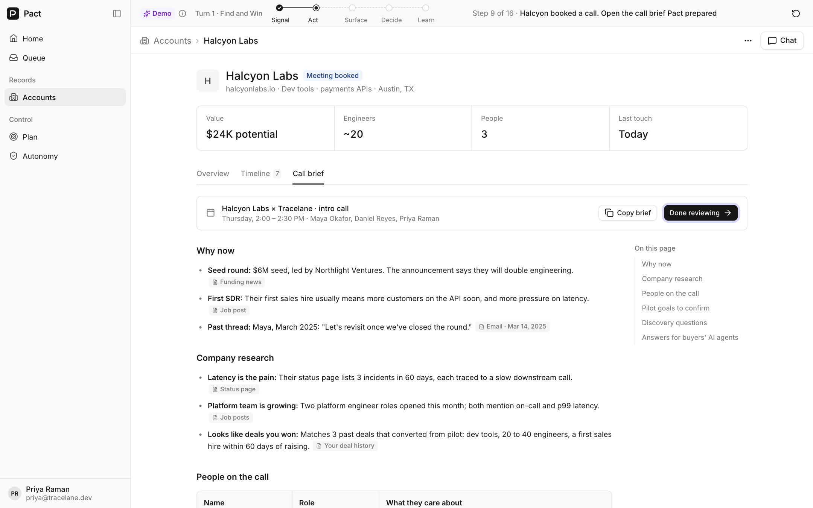
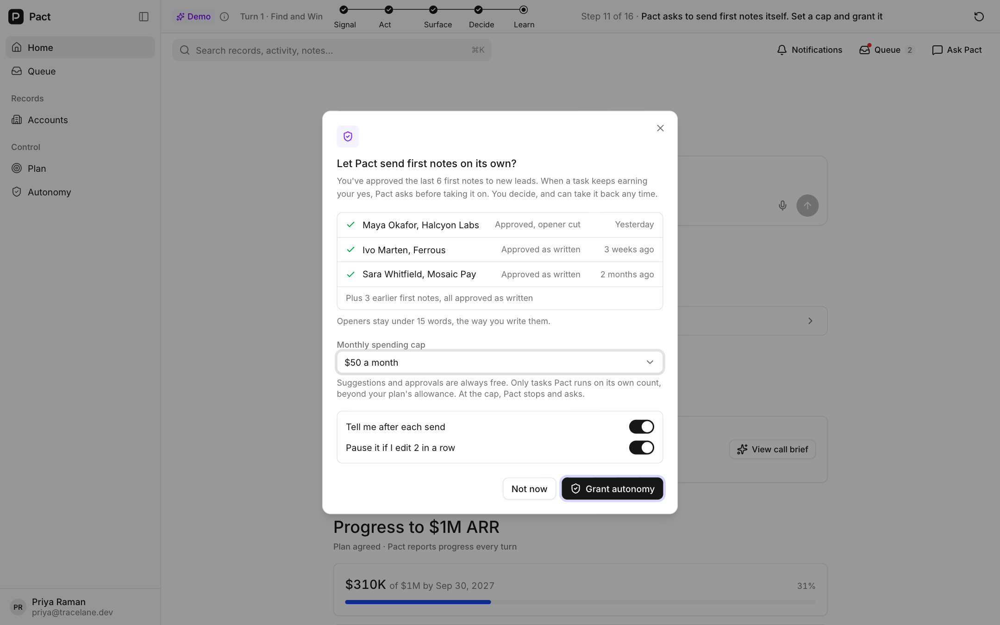
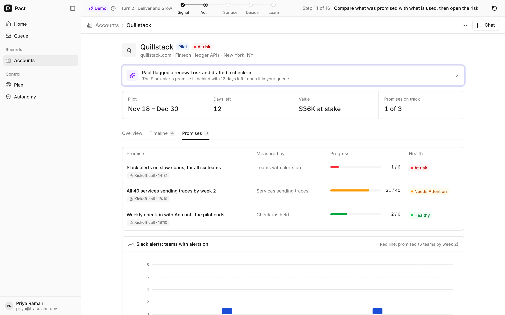
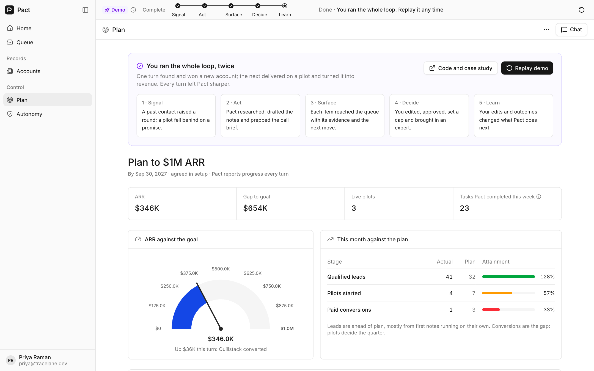

# Pact: the revenue loop, as an interactive prototype

**[▶ Try the live demo](https://nawaz-dalwai.github.io/pact-loop/)** · desktop, about 5 minutes, no sign-up

Pact is a concept for a self-improving revenue system for early-stage B2B founders. It replaces the CRM with one loop
that runs revenue end to end: it **suggests** the next move, **waits for the founder's yes**, and **learns** from every
decision, until a task has earned enough trust to run on its own.

This prototype lets anyone walk that loop twice, end to end, with no one there to explain it.



---

## The idea in one loop

| Stage | What Pact does | Where you see it |
|---|---|---|
| **Signal** | Watches email, calls, meetings, Slack, product usage, and outside news like funding and hiring | A past contact raises a round; a pilot falls behind on a promise |
| **Act** | Researches accounts, drafts notes, preps call briefs, tracks promises against usage | Account record, call brief, promise tracker |
| **Surface** | Speaks up unprompted, always with the evidence | The queue |
| **Decide** | The founder approves, edits or dismisses. Nothing runs without a yes | Draft review, autonomy offer, human expert |
| **Learn** | Every decision and outcome changes what Pact does next | "What Pact learned", plan progress |

## What the demo walks through

A guide strip on every screen shows where you are in the loop and the one thing to do next (it pulses).
The flow is deliberately fixed: every input is required, so every visitor sees the whole story.

**Setup.** Connect five sources, then let Pact build a pipeline from past email. Teach it the business by
**uploading what you already have** (pitch deck, ICP doc, sales playbook…) or by answering three questions. Agree a plan
Pact works back from the goal: $1M ARR.

**Turn 1 · Find and Win.** A past contact raises a seed round → Pact researches the account and drafts a first note →
the note reaches the queue with its evidence → you must **cut Pact's long opener before you can approve** → the reply
books a call and Pact preps the brief → Pact learns you write short openers → it **asks to send first notes on its own**,
and you have to set a monthly cap to say yes.

**Turn 2 · Deliver and Grow.** Two weeks later, a pilot is behind on a promise made on the kickoff call → Pact compares
promise and product usage, flags renewal risk and drafts a check-in that owns the miss → you approve it and **bring in a
human expert** → the pilot converts, and the plan and "What Pact learned" update.

| | |
|---|---|
|  **Setup:** documents in, cited findings out |  **Decide:** the draft, with Pact's reasoning beside it |
|  **Act:** a call brief, every line cited |  **Learn:** autonomy is offered, never assumed |
|  **Deliver:** promises from the call, tracked against usage |  **Control:** guardrails, run log, take it back |



## Design decisions

- **Evidence on everything.** Every suggestion, brief and finding carries its source as a citation chip (an email,
  a slide, a transcript timestamp, product usage). A founder should never have to take Pact's word for it.
- **Approval is the product, not friction.** Approving is free and fast; editing is how Pact learns. Turn 1 makes the
  visitor shorten Pact's opener before sending, and that edit later shows up as "Pact learned: you prefer short openers".
- **Autonomy is earned, capped and reversible.** Pact asks only after a clean approval record, granting requires a
  spending cap, it pauses itself after two edits in a row, every run is logged, and **Take back** is one click.
- **Start from what founders already have.** Seed-stage founders already have a deck, an ICP doc and a playbook. Uploading
  them turns setup into confirming pre-filled answers instead of filling in a form.
- **Teach where new, execute where strong.** Setup asks where the founder is strong. Drafts and briefs then either explain
  their reasoning (help me) or arrive ready to send (I'm strong).
- **Promises are tracked to renewal.** What was promised on a sales call becomes a measurable commitment, checked
  against product usage. That is what turns a pilot into revenue.
- **Built to be reviewed alone.** The guide strip, the pulse on the next action, "Skip time" when the story waits on the
  outside world, and a finish card with a recap mean nobody needs to present it.

### Decisions the prototype had to make

The product brief left these open, so the prototype commits to one answer each:

| Open question | Decision in the prototype |
|---|---|
| What happens to items the founder never answers? | They roll into a daily digest at the top of the queue; dismissing asks why |
| What actually sends? | The founder's own connected Gmail, only after approval |
| Buyers' AI agents want answers instantly. Approval or not? | Pre-approved answers only, each approved once (marked **Next**) |
| When does autonomy stop? | It pauses itself after 2 edits in a row (on by default), and stops at the monthly cap |
| How does Pact learn with little deal history? | A day-one import from past email, plus the founder's own documents |

## How it's built

React 19 · TypeScript · Vite · Tailwind CSS v4 · Radix UI primitives (shadcn-style components) · Zustand · React Router ·
Tiptap (email editor) · Recharts · Sonner · Puppeteer (end-to-end walkthrough)

- **The demo is a state machine.** [`src/demo/script.ts`](src/demo/script.ts) lists all 16 steps in order, each with
  its loop stage, route and hint. The guide strip, route guards, pulses and "Skip time" all read from it, so the story
  can't be broken by clicking around.
- **The store is the fake backend.** [`src/store`](src/store/index.ts) keeps the demo's state in `localStorage`, so a
  reload resumes where you left off. Restart from ↺ in the guide strip.
- **Scripted, not generated.** Pact's replies are fixed content that streams in word by word, with "Gathering
  context…" steps and citations. Some of it adapts to what you chose in setup (segments, skills, uploaded documents).
- **Static hosting.** Hash routes and relative asset paths mean `dist/` runs from any folder; GitHub Actions lints and
  builds every push and pull request, and deploys `main` to GitHub Pages.

```
src/
  demo/        script (the state machine), guide strip, notifications, queue counts
  data/        fictional accounts, sample documents, plan numbers
  features/
    onboarding/  connect · learn the business (upload or answer) · plan
    queue/       queue, draft review, expert request
    accounts/    accounts, account record (overview, timeline, promises), call brief
    autonomy/    autonomy offer and controls
    plan/        progress against the plan, what Pact learned, finish
  components/  design system: ui primitives, layout shell, chat, editor, charts
e2e/           headless-Chrome walkthrough of the whole demo
```

## Run it locally

```bash
npm install
npm run dev          # http://localhost:5173 (desktop, at least 1280 px wide)
npm run lint         # zero warnings
npm run build        # static site in dist/
npm run e2e          # with the dev server running; SKIP_DOCS=1 for the no-upload path
```

## Scope

This is a frontend prototype, built to test and show the product's interaction design.

- **Simulated:** connecting tools, uploads (sample files), research, drafting, sending, replies and product usage.
  Ask Pact replies with a fixed message.
- **Fictional:** every person, company and number. Prices are illustrative.
- **Not built:** a backend, real integrations, accounts, mobile layouts.

---

Designed and built by [@Nawaz-Dalwai](https://github.com/Nawaz-Dalwai).
