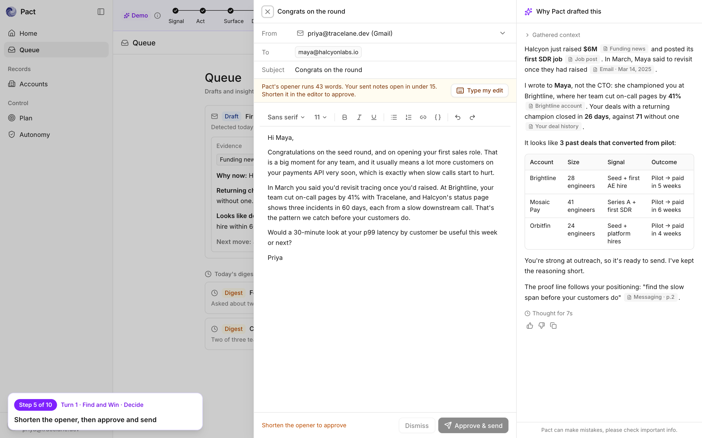
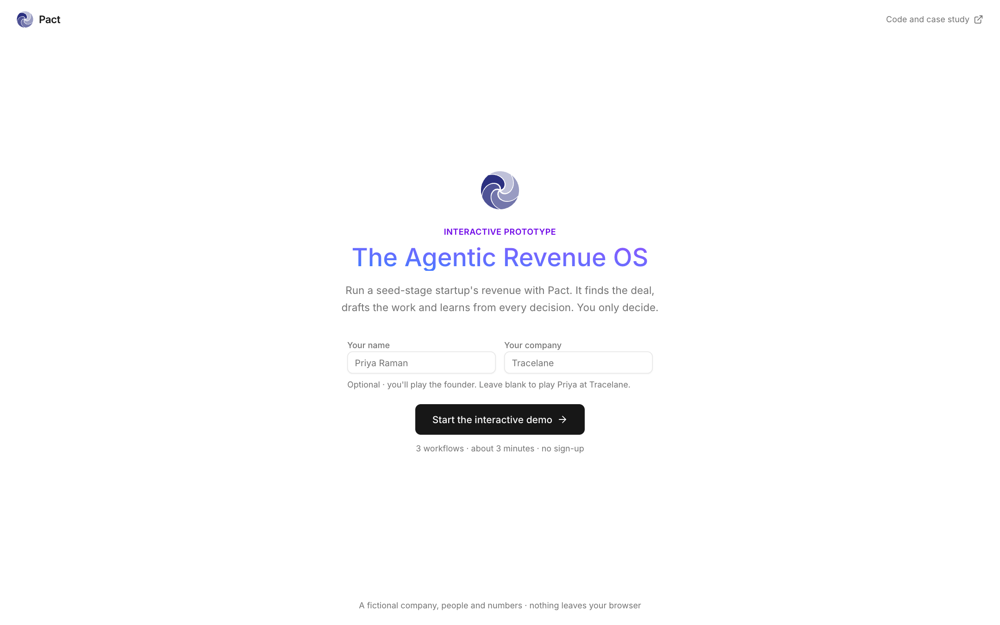
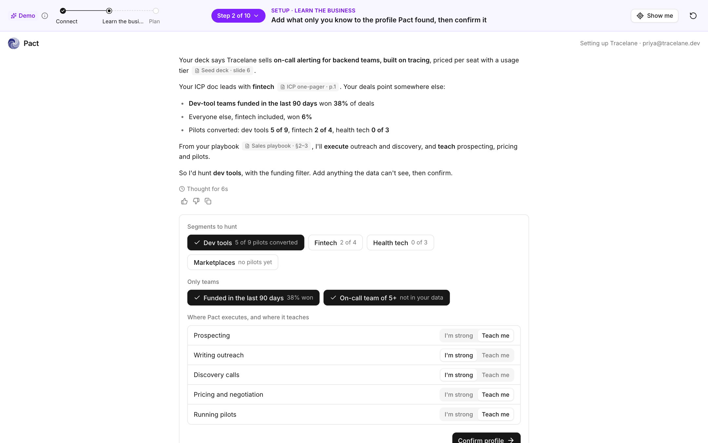
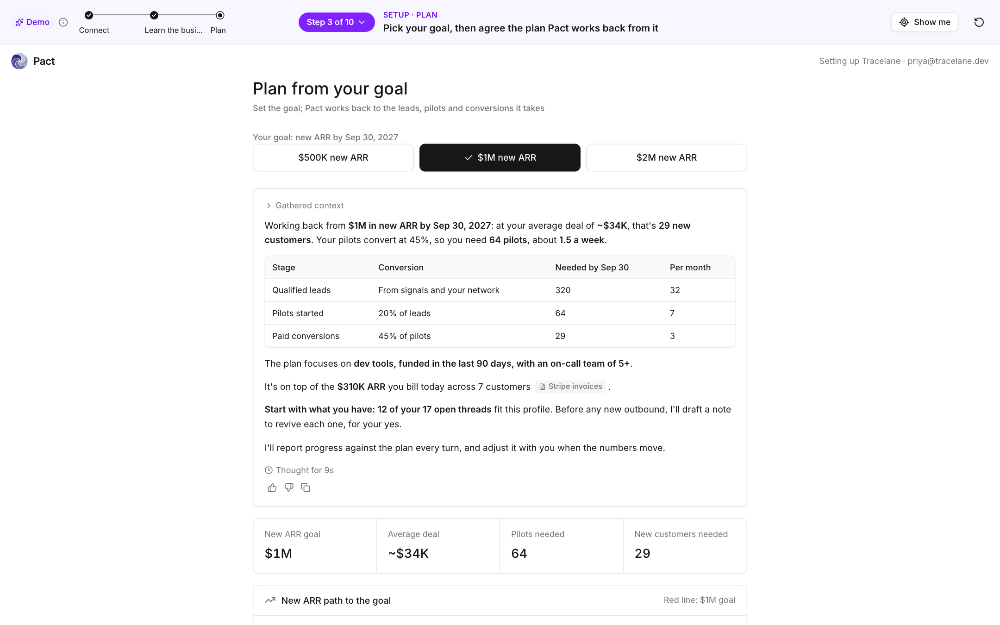
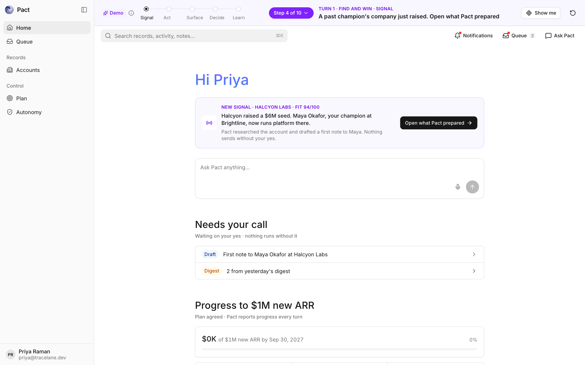
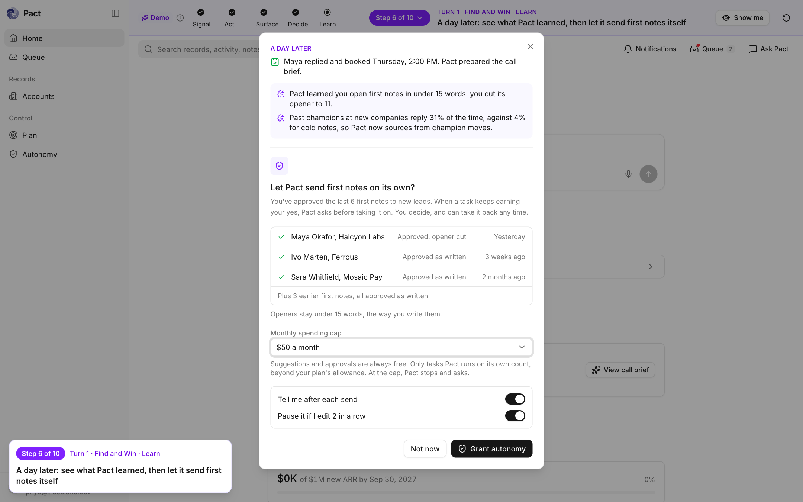
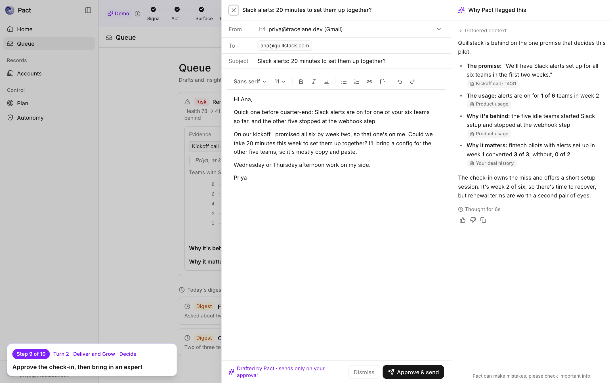
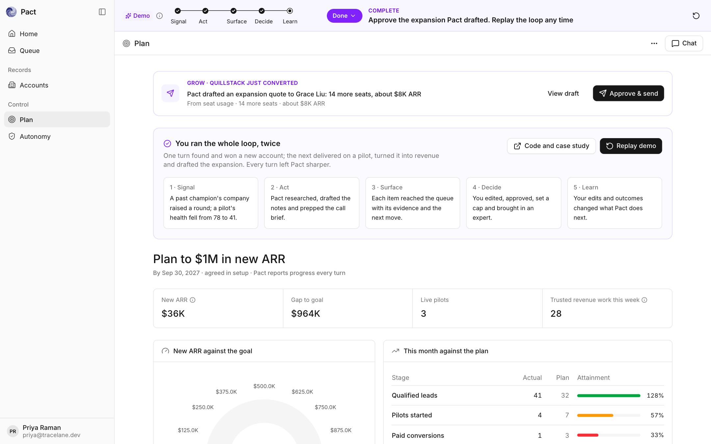
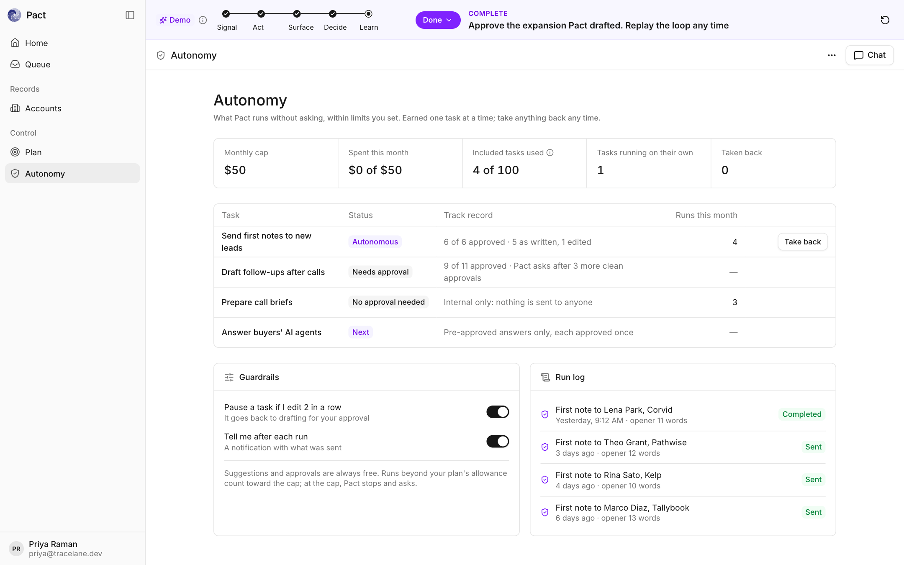

# Pact: the revenue loop, as an interactive prototype

**[▶ Try the live demo](https://pact-loop.vercel.app/)** · desktop, about 3 minutes, no sign-up

Pact is a concept for a self-improving revenue system for early-stage B2B founders. It replaces the CRM with one loop
that runs revenue end to end: it **suggests** the next move, **waits for the founder's yes**, and **learns** from every
decision, until a task has earned enough trust to run on its own.

This prototype lets anyone walk that loop twice, end to end, with no one there to explain it.

---

## The idea in one loop

| Stage | What Pact does | Where you see it |
|---|---|---|
| **Signal** | Watches email, calls, meetings, Slack, product usage, and outside news like funding and hiring | A past champion's company raises a round; a pilot falls behind on a promise |
| **Act** | Researches accounts, drafts notes, preps call briefs, tracks promises against usage | Account record, call brief, promise tracker |
| **Surface** | Speaks up unprompted, always with the evidence | The queue |
| **Decide** | The founder approves, edits or dismisses. Nothing runs without a yes | Draft review, autonomy offer, human expert |
| **Learn** | Every decision and outcome changes what Pact does next | "What Pact learned", plan progress |

## What the demo walks through

**16 clicks, about 2–3 minutes.** Every click is a decision the founder makes; everything Pact does in between plays
out on its own. A guide bar on every screen shows the exact step and the one thing to do next, with **Show me** and
**Take me there** if you get lost. Depth (the call brief, promises, the Autonomy page) stays one click away but optional.

**Setup.** Connect email (required), then connect or skip calendar, calls, Slack, billing and product analytics; the rest of the
journey adapts to what's connected (without product analytics, for example, Pact learns of a missed promise from Slack, or
notices the silence and asks). Pact builds a pipeline from past email. Hand it **sample documents** (pitch deck, ICP doc, playbook…) and it proposes
your profile, contradicting the ICP with your own deal data; you add "on-call team of 5+" and confirm. Pick a goal (new ARR by
Sep 30, 2027) and agree the plan Pact works back from it: at $1M, 29 new customers from 64 pilots, about 1.5 a week.

**Turn 1 · Find and Win.** A past champion's new company raises a seed round → open the draft Pact prepared, with its
research and evidence beside it → **cut Pact's long opener** and approve → a day later the reply books a call, Pact has the
brief ready and has learned two things → it **asks to send first notes on its own**, within a monthly cap.

**Turn 2 · Deliver and Grow.** Two weeks later, a pilot's health drops from 78 to 41 → open the check-in Pact drafted,
with the promise, the usage and the cause beside it → approve it and **bring in a human expert** → the pilot converts, and you
approve the **expansion quote** Pact drafted from seat usage.

| | |
|---|---|
|  **Start:** play the founder, under your own name |  **Setup:** Pact contradicts the ICP with your deals; you add what it can't see |
|  **Plan:** worked back from the goal you pick |  **Signal:** one card, one click to what Pact prepared |
|  **Learn:** what Pact learned, and autonomy offered within a cap |  **Deliver:** the promise, the usage and the cause, then a check-in |
|  **Grow:** an expansion quote, then a recap of the loop |  **Control:** guardrails, run log, take it back |

## Design decisions

- **Evidence on everything.** Every suggestion, brief and finding carries its source as a citation chip (an email,
  a slide, a transcript timestamp, product usage). A founder should never have to take Pact's word for it.
- **Approval is the product, not friction.** Approving is free and fast; editing is how Pact learns. Turn 1 makes the
  visitor shorten Pact's opener before sending, and that edit later shows up as "Pact learned: you prefer short openers".
- **Autonomy is earned, capped and reversible.** Pact asks only after a clean approval record, granting requires a
  spending cap, it pauses itself after two edits in a row, every run is logged, and **Take back** is one click.
- **Start from what founders already have.** Seed-stage founders already have a deck, an ICP doc and a playbook. Uploading
  them turns setup into confirming pre-filled answers instead of filling in a form.
- **Teach where new, execute where strong.** Setup asks where the founder is strong. Drafts and briefs then either explain
  their reasoning (help me) or arrive ready to send (I'm strong).
- **Promises are tracked to renewal.** What was promised on a sales call becomes a measurable commitment, checked
  against product usage. That is what turns a pilot into revenue.
- **Built to be reviewed alone.** The guide strip, the pulse on the next action, "Skip time" when the story waits on the
  outside world, and a finish card with a recap mean nobody needs to present it.

### Decisions the prototype had to make

The product brief left these open, so the prototype commits to one answer each:

| Open question | Decision in the prototype |
|---|---|
| What happens to items the founder never answers? | They roll into a daily digest at the top of the queue; dismissing asks why |
| What actually sends? | The founder's own connected Gmail, only after approval |
| Buyers' AI agents want answers instantly. Approval or not? | Pre-approved answers only, each approved once (marked **Next**) |
| When does autonomy stop? | It pauses itself after 2 edits in a row (on by default), and stops at the monthly cap |
| How does Pact learn with little deal history? | A day-one import from past email, plus the founder's own documents |

## Scope

This is a frontend prototype, built to test and show the product's interaction design.

- **Simulated:** connecting tools, uploads (sample files), research, drafting, sending, replies and product usage.
  Ask Pact replies with a fixed message.
- **Fictional:** every person, company and number. Prices are illustrative.
- **Not built:** a backend, real integrations, accounts, mobile layouts.

---

Designed and built by [@Nawaz-Dalwai](https://github.com/Nawaz-Dalwai).
